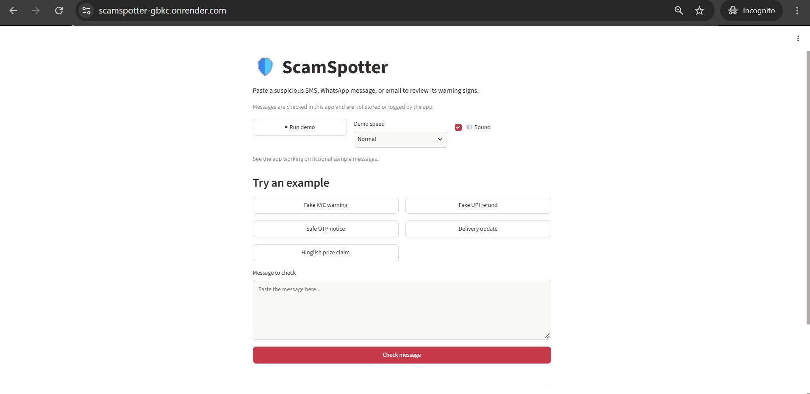
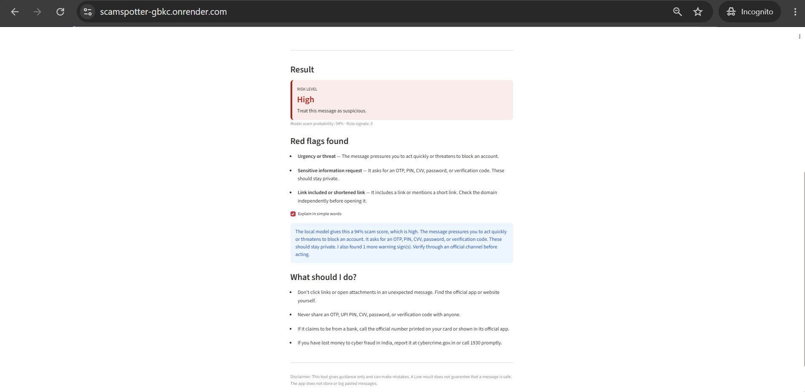
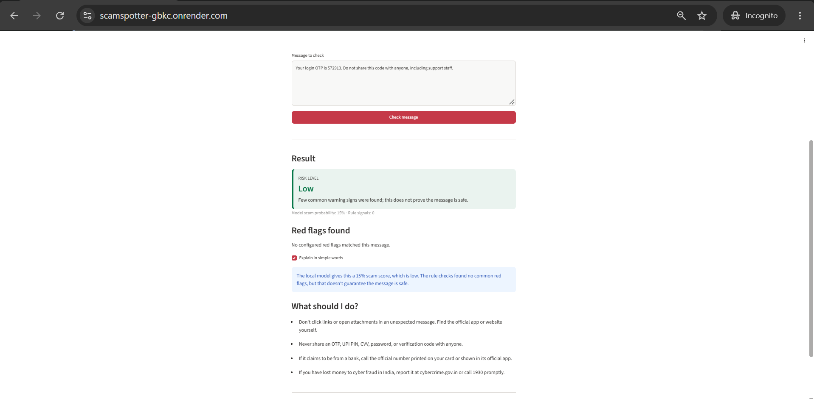
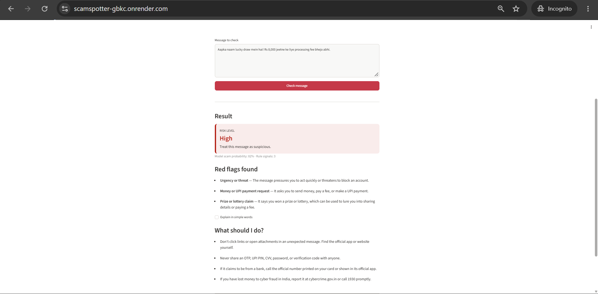
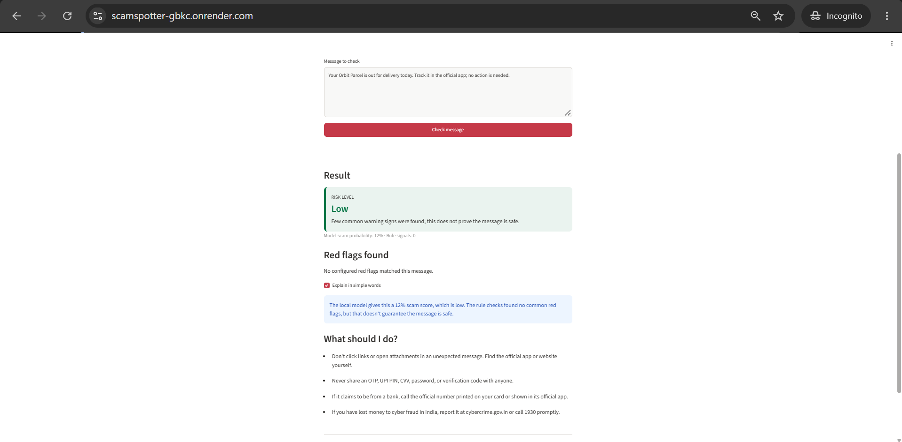
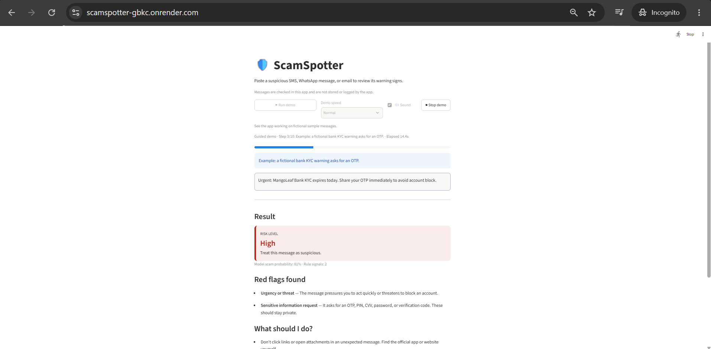

# ScamSpotter

**Live demo:** [ScamSpotter on Render](https://scamspotter-gbkc.onrender.com). This uses Render's free tier, so the first load can take up to a minute while the service starts.

An educational project for the Community Impact student AI hackathon. The app helps people pause and review suspicious SMS, WhatsApp, and email messages before they respond.

## Screenshots

*The home page offers sample messages and a place to check a message.*

*A suspicious KYC message receives a High result with warning signs and next steps.*

*A safety notice about an OTP receives a Low result; the screen still reminds users this does not prove safety.*

*A Hinglish prize message is flagged for urgency, a payment request, and a prize claim.*

*The optional explanation describes the score and lack of detected warning signs for a routine delivery update.*

*The guided demo types a fictional KYC warning and analyzes it with the app.*

## The problem

Scam messages can impersonate banks, government services, courier companies, and employers. They may pressure people to share an OTP or UPI PIN, pay a fee, open a link, or install an app. These messages can be difficult to judge, especially when they use urgent language or mix English and Hindi.

## The solution

Paste a message into the local Streamlit app to get a Low, Medium, or High risk estimate, readable red flags, and practical next steps. The app combines a scikit-learn text classifier with editable keyword and regular-expression rules. The training dataset is synthetic, and the model is a guidance aid: a Low risk result is not proof that a message is safe. It runs without a paid API; pasted text is not saved or sent to an outside service by the app.

## Features

- Color-coded Low, Medium, and High risk results.
- Red flags with names and plain-English explanations.
- Optional “Explain in simple words” summary based only on the model score and detected flags.
- Guided demo that types fictional examples and runs each through the live rules and model.
- Optional audio narration for the guided demo, generated from scene captions rather than scam messages.
- Practical advice about links, OTPs, official bank contact details, and reporting cybercrime in India.
- Clickable sample messages, including safe notices and Hinglish examples.
- Local TF-IDF word and character features with Logistic Regression.
- Training metrics and a separate tricky-message benchmark.

## Install and run

Use Python 3.10 or newer. Open a terminal in the project folder and run:

~~~powershell
python -m venv .venv
.venv\Scripts\Activate.ps1
python -m pip install -r requirements.txt
python data/generate_dataset.py
python model.py
python -m streamlit run app.py
~~~

The generator writes 400 synthetic examples (200 scam and 200 safe) to data/messages.csv. The training command prints accuracy, scam precision and recall, confusion matrices, evaluates the separate challenge set, and saves the trained classifier to model.pkl. Running python model.py before the app is optional: if model.pkl is missing, the first message check trains the model locally, shows a progress spinner, and caches the result. If the training data is unavailable, the checker continues with rules-only guidance and displays a notice.

In the app, select “▶ Run demo” to see the example walkthrough. It uses fictional messages, the same live result renderer as the regular checker, and does not save or log message text.

To generate the optional narration audio, install the development tools and run:

~~~powershell
pip install -r requirements-dev.txt
python tools/generate_audio.py
~~~

The script reads each scene's editable narration text from demo.py and writes scene_01.mp3 through scene_10.mp3 in assets/audio/. It uses edge-tts with the en-IN-NeerjaNeural Indian English voice. These short generic narrations do not read the sample scam messages or user-pasted messages aloud. If audio files are absent, the demo continues silently.

Run the tests:

~~~powershell
python -m pytest -q
~~~

## Tech stack

- Python for the application and data-generation script.
- Streamlit for the user interface.
- scikit-learn for TF-IDF features, Logistic Regression, and evaluation metrics.
- joblib for saving and loading the fitted classifier.
- Python's csv and re modules for reading the dataset and applying rules.

## Dataset

data/generate_dataset.py creates fictional messages using editable templates and fictional names, brands, amounts, and example domains. The generated data includes fake KYC and account warnings, OTP and UPI requests, prize claims, job offers, courier alerts, and safe delivery, transaction, OTP, appointment, and chat messages. Some examples use Hinglish.

data/challenge_messages.csv is a separate, small set of tricky examples. It includes genuine-sounding bank alerts, a safe OTP notice, a completed UPI payment, a delivery message, a very short chat, link-free scams, Hinglish, and very short scam text. These challenge examples are kept separate from the generated training data.

All examples are synthetic. They do not represent real people, companies, or actual messages.

## Model performance

In the latest local run:

- Generated-data held-out split: 100% accuracy, 100% scam precision, and 100% scam recall on 80 messages (40 safe and 40 scam).
- Separate tricky-message set: 100% risk accuracy on 10 messages (5 safe and 5 scam).

These are small educational checks, not evidence of real-world accuracy. The generated examples share templates, so the random held-out split can be overly optimistic. The challenge set is also too small to represent the variety of real messages. Treat both scores as snapshots of these specific examples, not a guarantee of performance.

## Limitations

- The model learns from a small, synthetic dataset and may not recognize new scam tactics, local language variations, or misspellings.
- Rules can produce false positives or miss subtle requests. A message with no detected flags is not necessarily safe.
- A risk score is guidance, not proof. Always verify through an organization's official app, website, or independently sourced phone number.
- No real-world, privacy-reviewed message corpus has been used to measure this project.
- The app does not store or log pasted messages, but users should still avoid entering private information into demos they do not control.

## AI tools used

OpenAI Codex assisted with project scaffolding, synthetic dataset generation, red-flag rules, the local classifier, Streamlit UI and demo, documentation, and pytest coverage. The demo narration voice was generated locally from the editable scene narration using `edge-tts` (en-IN-NeerjaNeural); it does not read scam messages aloud. I reviewed and changed the generated code, tested the rules and demo flows, and checked results against fictional sample messages. I also reviewed the README's performance claims against a fresh local model run and the recorded small test sets. The deployed app runs on Render's free tier.

## What I learned

Building this taught me that a text model only sees patterns in examples, not the real-world truth behind a message. Word and character TF-IDF features help it recognize familiar wording and small spelling changes, while the rules give people a clearer reason for a warning. I also learned that similar synthetic examples can make a random test split look much better than the app may perform on new messages. The small tricky-message check is useful for finding gaps, but it is not enough to claim real-world accuracy. Finally, Streamlit reruns the app after interactions, so I had to keep the checked message and analysis in session state to preserve the result when the explanation checkbox changes.

## What I'd build next

- Collect a larger, carefully reviewed dataset with consent and privacy protections.
- Add more regional-language and transliterated Hinglish examples.
- Evaluate on a larger, independently collected test set and report precision, recall, and false-positive rates by message type.
- Improve handling of message context, such as the difference between an OTP request and a safe “do not share your OTP” notice.
- Add clear feedback controls so users can report incorrect classifications without saving their original message.
- Explore a free, local language model behind the existing explanation interface, while keeping message text on-device.

## Credits

- Streamlit — app interface.
- scikit-learn — text features, classifier, and evaluation metrics.
- joblib — model persistence.
- edge-tts — generated Indian English demo narration (development tool only).
- The demo's small MP3 frame reader — reads narration duration without an extra runtime dependency.
- pandas — Python data-analysis library acknowledged here; the current project reads CSV files with Python's built-in csv module and does not require pandas.
